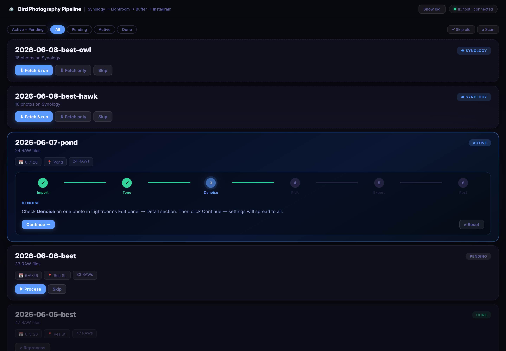
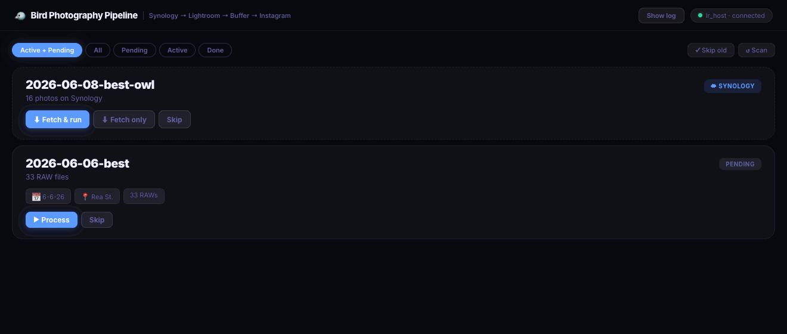
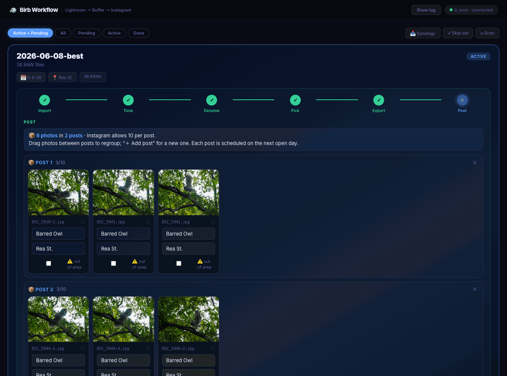
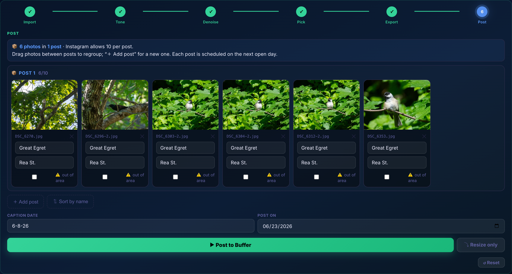

# 🐦 Bird Photography Pipeline

**A one-screen pipeline for bird photography: Synology → Lightroom → Buffer → Instagram.**

> The engine behind **[@birdsofnorthandover](https://instagram.com/birdsofnorthandover)** — every post on that feed runs through this.

Pick an album in Synology Photos, hit **Fetch & run**, and the pipeline pulls the RAWs and walks them through import, auto-tone, denoise, picking, and export in Lightroom Classic — then resizes, captions, splits, and schedules the keepers to Instagram via Buffer. All from a single dark-mode web UI.



---

## Why

These shots happen on neighborhood walks — dog on the leash, one-year-old riding on my back, camera over the shoulder. You get home with a few hundred RAWs and a handful of keepers, and the tedious part is everything *after* the shutter: repetitive Lightroom clicking, manual resizing, caption typing, and Buffer queue juggling — especially when a good walk turns into several posts (Instagram caps carousels at 10 images).

Bird Photography Pipeline automates the mechanical parts and keeps the judgment calls (which shots, which species, how to group) one drag away.

---

## Start from Synology

Your Synology Photos albums show up right in the batch list as cards. Hit **⬇ Fetch & run** and it downloads the RAW originals (with a live progress bar) and kicks off the whole pipeline — no manual file shuffling.



- Recent albums surface automatically; older/posted/skipped ones tuck behind a toggle.
- **Skip** hides albums you'll never post; posted albums are remembered so they don't resurface.
- Originals stay safe on the NAS, so local RAWs are auto-deleted after a successful post to reclaim disk.
- Prefer manual? Drop a `YYYY-MM-DD-<suffix>` folder of RAWs into `~/Downloads` and it appears as a batch too.

---

## The pipeline

Each batch moves through six stages, shown as a live progress bar you can rewind to any point:

| Stage | What happens |
|-------|--------------|
| **1 · Import** | The folder is imported into Lightroom Classic |
| **2 · Tone** | Select All → Auto Settings across the batch |
| **3 · Denoise** | You set denoise + CA removal on one photo; it’s copied to all |
| **4 · Pick** | You flag your keepers in Lightroom |
| **5 · Export** | Export with Previous → `~/Desktop/birbs/` (captured by modification time) |
| **6 · Post** | Resize, caption, group into posts, and schedule to Buffer |

---

## Posting: drag photos into posts

The post screen organizes exports into **draggable lanes** — one lane per Instagram post. Photos seed in natural filename order, then you regroup them however the species/scenes break up. Each lane is capped at Instagram’s 10-image limit (the counter turns red and blocks posting if you go over), and every post is scheduled on the next open day in your Buffer queue.



- **Drag** any photo between posts to regroup; **＋ Add post** for a new lane.
- **⇅ Sort by name** snaps everything back to filename order.
- **✕** moves a photo to an *Excluded* tray (won’t post); drag it back to restore.
- Per-photo **species / location / ⚠️ out-of-area** fields, with type-once **fill-down** to the photos below.

A single post (≤ 10 photos) keeps it simple — one carousel, with a manual schedule date if you want one:



---

## birdqueue: posting without Buffer

Buffer was doing five jobs here — hosting images, holding a dated queue, telling us
the next open day, remembering past captions for autocomplete, and giving a UI to
reorder and reschedule. `birdqueue.py` does all five, on hardware we own, with no
session cookies to go stale.

**It runs on the Pi, not the Mac.** A post scheduled for Thursday has to fire with
nobody logged in — this Mac sleeps aggressively and its launchd agents need a login
session. The Pi is already always-on.

```
Mac (Lightroom work)                     birdpi (always on)
  resize + caption          ──push──>    SQLite queue + images on disk
  /queue page               <──API──>    publisher thread, ticks every 60s
                                         due? → host images → publish → record
```

- **`/queue`** in the web UI: drag to reorder, edit the date inline, pause, delete,
  post-now. Same one-post-per-day slotting as Buffer, so "next open day" means what
  it always did.
- **Images reach Meta via Tailscale Funnel.** Meta insists on fetching by URL, so
  the Pi exposes each image publicly for the length of one publish and then stops.
  `MEDIA_BACKEND=s3` is the alternative if you'd rather use a private bucket.
- **Species autocomplete** now comes from `docs/species_history.json` (144 names,
  extracted from the Buffer export) rather than mining Buffer's last 50 posts.
- The Mac reaches the Pi through an SSH tunnel — `launchd/com.scott.birdqueue-tunnel.plist`
  — because birdqueue binds loopback-only and this Mac runs Tailscale in userspace
  mode and can't route tailnet IPs.

### Gotchas that cost real time

- **Funnel needs ~20–30s to start serving** after `tailscale funnel --bg`, and the
  hostname resolves to several ingress addresses that propagate independently. One
  successful probe proves nothing: Meta opens its own connection and can hit a node
  that isn't ready. The readiness gate requires **5 consecutive 200s on fresh
  connections** before handing URLs over.
- **`sudo` can't work from the service** — it sets `NoNewPrivileges=true`, which
  disables setuid. Use `tailscale set --operator=scott` instead and keep the
  hardening.
- **Config errors must not count as failed attempts**, or a few minutes of bad
  config permanently exhausts every queued post's retry budget. Hence `ConfigError`.
- **Publishing to your own account needs no Meta App Review** (verified Oct 2026).
  A carousel counts as one post, ≤10 images. Quota is 50–100/24h — query
  `content_publishing_limit` live rather than hardcoding — and there's a separate
  **200 API calls/hour** ceiling, so a 10-image carousel (~22 calls) caps near 9/hour.

### Migration state

Buffer history is exported to `docs/buffer_history_export.json` (223 posts,
2026-03 → 2026-10). **Don't cancel Buffer until birdqueue has posted successfully a
few times** — both paths run side by side and the Buffer code here is untouched.

---

## Quick start

### Requirements

- macOS with **Lightroom Classic**
- **Docker Desktop**
- **Python 3.12** (pyenv or system)
- **Chrome** logged in to [publish.buffer.com](https://publish.buffer.com)
- A Buffer API token → [publish.buffer.com/settings/api](https://publish.buffer.com/settings/api)
- *(optional)* **Synology Photos** + a DSM account, for the Fetch-from-NAS front door (creds in `.env`)

### Install & run

```bash
git clone git@github.com:scottx611x/bird-photography-pipeline.git
cd bird-photography-pipeline

export BUFFER_TOKEN="your_token_here"   # or add to your shell profile

./bird up          # build + start the container and the Lightroom bridge
```

Open **[http://localhost:8765](http://localhost:8765)**.

`bird up` extracts your Buffer session cookies from Chrome, builds and starts the Docker container, and launches `lr_host.py` (the Mac-side Lightroom bridge) in the background.

```bash
./bird status      # container + bridge status
./bird logs        # tail container logs
./bird down        # stop everything
```

---

## Usage

### 1. Name your batch folder

Drop a folder in `~/Downloads` named `YYYY-MM-DD-<suffix>` and it appears in the UI (it rescans every 30s, or hit **Scan**). The suffix sets the default caption location:

| Folder | Default location |
|--------|------------------|
| `2026-06-08-best` | Rea St. |
| `2026-06-08-pond` | Pond |
| `2026-06-08-mojo-and-momma` | Mojo And Momma |

### 2. Run it through the UI

Click **Process** on a pending batch and follow the prompts in the progress bar — the UI tells you exactly what to do in Lightroom at each step and auto-advances when it detects your exports.

The batch list defaults to the **Active + Pending** filter so you see what’s in flight; switch to **Done** to review posted batches (their thumbnails load on demand to keep things fast).

### 3. Post

On the Post step, assign species, group photos into posts by dragging, and hit **Schedule N posts to Buffer**. Each post lands on the next open day in your queue.

### CLI (optional)

`bird_post.py` can post directly without the UI:

```bash
# Single carousel, auto-scheduled to the next open slot
python bird_post.py --file DSC_5360.jpg DSC_5361.jpg \
    --species "Sharp-shinned Hawk" --location "Rea St." --date 6-8-26

# Out-of-area sighting (adds a ⚠️ prefix)
python bird_post.py --file DSC_1234.jpg \
    --species "Common Loon" --location "Sand Pond, ME" --date 6-8-26 --out-of-area

# Just resize into .ready/ — no upload, no post
python bird_post.py --file DSC_5360.jpg --resize-only
```

Exports are color-managed to sRGB, EXIF-rotated, and saved at full resolution (long edge capped at 4096px) with JPEG quality dialed to fill Buffer’s ~8 MB limit — so Instagram does a single clean downscale instead of compressing an already-shrunken image.

---

## Architecture

```
Browser  (localhost:8765)
   │  HTTP poll + SSE log stream
   ▼
Docker — server.py (Flask)         orchestration, Buffer API, image pipeline
   │  host.docker.internal:8766
   ▼
lr_host.py  (Mac, background)      HTTP → AppleScript bridge
   │  osascript
   ▼
Lightroom Classic                  import · tone · denoise · export
```

| File | Role |
|------|------|
| `server.py` | Flask web UI, workflow state machine, Buffer scheduling |
| `templates/index.html` | Single-page UI — vanilla JS, dark theme, drag-and-drop lanes |
| `lr_host.py` | Mac-side HTTP bridge that triggers Lightroom automation |
| `lr_auto.py` | AppleScript wrappers for import / tone / denoise / export |
| `bird_post.py` | Resize + sRGB convert, upload to Buffer’s S3, queue to Instagram |
| `bird` / `start.sh` | Start, stop, and status helpers |

---

## Environment variables

| Variable | Required | Description |
|----------|----------|-------------|
| `BUFFER_TOKEN` | Yes | Buffer API bearer token |
| `BUFFER_COOKIES` | Auto | Set by `bird up` / `start.sh` from your Chrome session |
| `SYNO_HOST` / `SYNO_USER` / `SYNO_PASS` | For Synology | DSM host + account for the Fetch-from-NAS front door (in `.env`; a device token is cached after a one-time 2FA code so logins stay unattended) |
| `MAC_HOME` | No | Home dir inside Docker for path translation (default `/Users/scott`) |

---

*Personal project — built around neighborhood dog-walks with a toddler on board and a camera over the shoulder, feeding [@birdsofnorthandover](https://instagram.com/birdsofnorthandover). 🪶*
